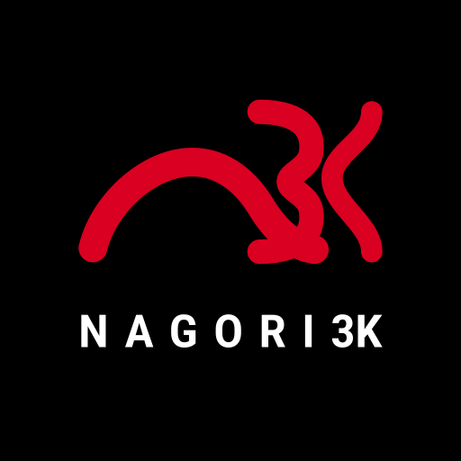
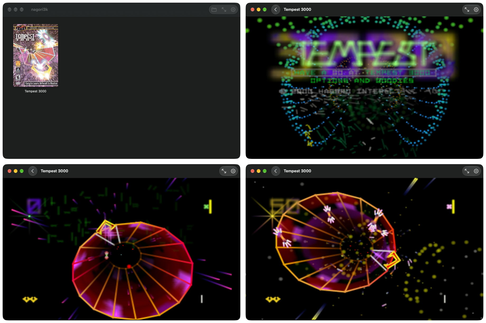

<p align="center"></p>

# nagori3k

*Nagori* (名残): the trace that lingers after something has passed.

nagori3k exists to bring **Tempest 3000** back for fans of Jeff Minter. The
game was released in 2000 for NUON, a games platform built into a handful
of DVD players, and it has been out of reach for most people ever since:
the players are scarce, and for years no emulator could run it at speed.

The aim is a native app for Mac, and then Android, that plays Tempest 3000
properly, with nothing to configure:

- a library built from a folder of your own disc images;
- controller support and button remapping;
- the scanline look switched on or off;
- an on-screen controller on Android phones and tablets.

There is no iPhone or iPad version planned for now. Tempest 3000 only runs
at speed with a dynamic compiler, and Apple does not allow apps on those
devices to use one.

Other NUON games should work too, but Tempest 3000 is the one this project
is measured against.

**Made with AI.** The code in this repository, and the Arm64 compiler added
to the emulator core, were written with an AI coding assistant, directed
and play-tested by Jake Smith.

<p align="center"></p>

<p align="center"><em>The Mac app: the library, the title screen, and the first level.</em></p>

## Playing Tempest 3000: stick to play, d-pad for your initials

The left stick turns the claw. When you make the high-score table, enter
your initials with the **d-pad**, not the stick.

The reason is in the game. Tempest 3000 can be played with a rotary
spinner, and the stick reaches it as one, because that is the only analogue
input the game handles well. On the name-entry screen the game treats one
click of a spinner as one letter, so the lightest touch of the stick runs
through half the alphabet. And while a spinner is connected, the game
ignores the d-pad on that screen altogether. So the app only lets the game
see the spinner while the stick is actually moving: the moment it is at
rest, or you press the d-pad, the spinner is gone and the d-pad is in
charge. The same goes for choosing your starting level.

## Two ways to feel the claw: T3K and Nagori

Under Options, Controls, there are two sliders, Sensitivity and Weight, and
two buttons that set them both.

| | Sensitivity | Weight | What it is |
|---|---|---|---|
| **T3K** | 100% | 0% | The game as it was |
| **Nagori** (the default) | 140% | 100% | A modern reading of it |

**T3K** adds nothing to the original. The game's response to its spinner
was measured rather than guessed: one click moves the claw about a seventh
of a lane, and the game will not move it more than 15/16 of a lane in a
frame. Sensitivity 100% means a full push of the stick, or a full squeeze
of a trigger, asks for exactly that top speed and no more. Weight 0% means
the claw answers the stick directly, with only the short easing the game
itself applies. This is the baseline both scales are measured from.

**Nagori** is how this app is meant to be played: a more modern
interpretation, in line with Jeff Minter's later tube shooters such as TxK
and Tempest 4000, where the claw glides rather than steps. The stick and
triggers drive a weighted flywheel, after the heavy knob on the arcade
Tempest, so the claw gathers speed, carries on for a moment when you let
go, and comes to rest. Sensitivity 140% reaches the game's top speed at
about four fifths of the stick's travel. Weight 100% is the weight settled
on by play, and what the scale is named after; the slider goes on to 200%,
tapering so that even the heaviest wheel stops.

Neither changes the game itself, only what your hands send to it, and the
d-pad works the same with both.

## A demanding game, and what it has been tested on

Tempest 3000 is hard work to emulate. The NUON had four processors running
at once, and the game uses all of them flat out: even the original players
dropped frames in the busiest scenes. Here every instruction for all four
is translated into Arm64 code as the game runs. With that translation
switched off, an M4 Pro manages about 5 frames a second, so a fast, recent
processor is not optional.

It has been played on exactly two devices:

| Device | Chip | System | Result |
|---|---|---|---|
| Mac mini (2024) | Apple M4 Pro | macOS 27.2 | 30 frames a second in ordinary play, the original's speed |
| Xiaomi Pad Mini | MediaTek MT8799 | Android 16 | The same |

On both, the busiest later levels dip to somewhere between 18 and 26
frames a second. Both chips are among the fastest of their kind. Nothing
slower has been tried, on either platform, so how it runs on an older Mac,
a mid-range tablet or a phone is not known. If you try one, switch on the
frame rate counter under Options: in ordinary play it should sit at 30.

## Status

Early. The emulator core runs Tempest 3000 at the speed of the original
hardware, and there are first versions of a Mac app and an Android app
(Android 10 or later, Arm64, tablets with a controller for now). The Mac
app has:

- a library built from a folder you choose, with cover art;
- play in a window or full screen, with a game controller or the keyboard.
  In full screen the game has the whole display: Command-F enters and
  leaves it, Escape leaves it, and the pointer is put away;
- an optional frame rate counter in the top right corner, showing how many
  frames a second the game itself is drawing;
- settings for the analogue stick (sensitivity and weight), an option to
  turn the claw with the analogue triggers instead, squeezing harder to go
  faster (worth trying), scanlines, a
  frame rate limit (uncapped, 30, 24 or 20), stretching the 4:3 picture to fill a wide
  screen (off unless you ask), and Tempest 3000's high scores;
- button remapping for controller and keyboard, on a Controls tab with
  the analogue settings.

It needs macOS 14 or later on an Apple silicon Mac. It is built by
`./build.sh` into `build/nagori3k.app`, signed for the Mac it was built on
only; `mac/release.sh` makes the signed, notarised disk image that is on
the releases page, beside the Android APK.

Tempest 3000 has no widescreen mode: it never asks the system what shape
the screen is. Stretching the picture is the only way to fill a 16:9
display, and it makes everything a third wider than it was drawn. On a
display wider than that, full screen stops at 16:9 with black bars either
side unless you switch that off.

Cover art is not bundled. The app looks beside each game for a picture
with the same name (or `cover`, `folder` or `boxart`, `.png` or `.jpg`),
and otherwise asks Wikipedia for the cover of an article with exactly the
game's title, keeping what it finds in
`~/Library/Application Support/nagori3k/boxart`. A game with no match gets
a plain tile.

Underneath the app:

- `host/` - the host layer: loads the core and gives a frontend the
  picture (an OpenGL texture), the sound, the controller and the settings
  through a small C interface (`host/nagori_host.h`).
- `mac/nagori_cli.mm` - a window, sound, a game controller and the
  keyboard, and nothing else.

### Building and running

On an Apple silicon Mac with Xcode's command-line tools and CMake:

```
git clone --recurse-submodules https://github.com/jake74/nagori3k
cd nagori3k
./build.sh
open build/nagori3k.app                         # the app
build/nagori-cli "/path/to/Tempest 3000.iso"    # or the bare player
```

For scripts and tests the app takes `--play <disc image>`,
`--quit-after <seconds>`, `--full-screen yes` and `--snapshot <directory>`
(which writes pictures of its screens and quits). Each option needs a
value: AppKit takes a word left over on the command line as a file to
open, and then no window appears.

In the bare player, a controller is picked up if one is connected: left stick or d-pad to move,
the face buttons to fire and jump, Options/Menu for Start. On the keyboard:
arrows, Z (fire), X, Return (Start), Esc to quit. Dragging the mouse in the
window turns the claw like a spinner.

Settings are passed as `--option key=value`; the ones that matter:

| Option | Values | What it does |
|---|---|---|
| `nuance_controller` | `analog stick`, `d-pad only` | The left stick drives a weighted flywheel, in the spirit of the arcade Tempest's spinner. The d-pad always works. |
| `nuance_spinner_sensitivity` | `10%` to `400%` | How fast full stick turns. |
| `nuance_spinner_inertia` | `0%` to `200%` | The flywheel's weight. Default `100%`. |
| `nuance_max_fps` | `30`, `24`, `20`, `15`, `unlimited` | Tempest 3000 plays faster the faster it draws; 30 is right for it. |
| `nuance_scanlines` | `enabled`, `disabled` | The CRT look. |
| `nuance_t3k_high_scores` | `keep`, `do not keep`, `erase` | The original lost its high scores at power-off. These are kept. |
| `nuance_skip_controller_message` | `enabled`, `disabled` | Skips the game's "controller configuration has changed" screen. |

## Standing on other people's work

None of this would exist without the people below, and nagori3k is a thin
layer on top of what they built. It is offered with great respect for their
work.

- **Mike Perry** wrote **Nuance**, the NUON emulator, between 2002 and
  2007. He did it in a clean room, from the NUON SDK's architecture
  documents and his own tools, and then released the source. Emulating four
  custom processors and their BIOS from documentation alone is a remarkable
  piece of work, and it is the foundation of everything here.
- **Carsten Wächter (toxie)** picked the released source up in 2020, in
  honour of its original author, and has carried it forward as
  **[NuanceResurrection](https://github.com/andkrau/NuanceResurrection)**
  together with its contributors. Years of careful fixes to timing, video,
  audio and the dynamic compiler are why games run as well as they do.
- **WizzardSK** ported NuanceResurrection to Linux and made it a libretro
  core, which is what makes it possible to put a new front end on it at
  all.
- **Everyone else who has contributed to NuanceResurrection**, and the
  NUON community that has kept the platform, its documentation and its
  games alive for a quarter of a century.
- **Jeff Minter and Llamasoft**, for Tempest 3000 itself, and **VM Labs**,
  for the strange and ambitious machine it ran on.

The emulator core used here is a fork of NuanceResurrection,
[jake74/NuanceResurrection](https://github.com/jake74/NuanceResurrection),
included as a submodule in `core/`. The fork adds an Arm64 dynamic compiler
and macOS support. If you want a NUON emulator for Windows or Linux, or
want to help with emulation itself, NuanceResurrection is the project to go
to.

## What this project does not include

- **No games.** You need your own Tempest 3000 disc and an image made from
  it.
- **No VM Labs BIOS.** The core uses NuanceResurrection's own clean-room
  BIOS replacement.

## Licence and trademarks

**No ads, no selling, no profit.** nagori3k is free and will stay free.

The code in this repository (the apps and the host layer; everything
outside `core/`) is Copyright (c) 2026 Jake Smith, under the
[3-Clause BSD licence](LICENSE). That is the licence the NuanceResurrection
contributors use for their own work, chosen so that anything useful here
can go back to the emulator.

The emulator core in `core/` is not covered by that file. It has its own
terms, in `core/License.txt`: Mike Perry's original Nuance may not be
redistributed for profit, by itself or as part of any other package, and
the later contributions are 3-Clause BSD. Every build of nagori3k contains
the core, so that condition travels with every copy of the app: nobody may
sell it or a version of it.

The name nagori3k and its logo are not part of the licence. If you make
your own version, please give it its own name and icon.

NUON is or was a trademark of Genesis Microchip, Inc. Tempest is a
trademark of Atari. This project is not affiliated with or endorsed by
either, or by Llamasoft.
